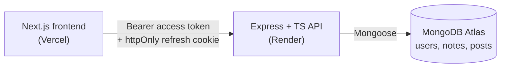

# Secure Notes - Feature Spec

_Living document. Only updated when a module passes verification. Last updated: 2026-11-18 01:05 (UTC+6)._

## Overview

A note-taking REST API (Express + TypeScript + MongoDB/Mongoose) with JWT authentication, bcrypt password hashing and two roles, plus a minimal Next.js frontend. The task is graded mainly on the indexing strategy (every list and read backed by an index declared with `schema.index()`, and no unnecessary indexes) and on two MongoDB aggregation scenarios.

Source: `Backend Interview Task (1) (1).pdf` (Care Guide BD).

## Architecture

## Milestones

| Milestone | Modules | Status |
| --- | --- | --- |
| [Milestone 1 - Foundation](./milestone-1-foundation/overview.md) | Project setup, Data models | not-started |
| [Milestone 2 - Auth](./milestone-2-auth/overview.md) | Auth core, RBAC and profile | not-started |
| [Milestone 3 - Notes](./milestone-3-notes/overview.md) | Notes CRUD, Admin notes | not-started |
| [Milestone 4 - User management](./milestone-4-user-management/overview.md) | Admin users | not-started |
| [Milestone 5 - Posts and aggregations](./milestone-5-posts-and-aggregations/overview.md) | Posts and $lookup, Interests aggregation, Index verification | not-started |
| [Milestone 6 - Frontend](./milestone-6-frontend/overview.md) | Frontend foundation, Frontend user pages, Frontend admin pages | not-started |
| [Milestone 7 - Deployment](./milestone-7-deployment/overview.md) | Deploy | not-started |

## Completed modules

| Module | Verified | What it delivers |
| --- | --- | --- |
| [M1 / Project setup](./milestone-1-foundation/module-1-project-setup/overview.md) | 2026-11-18 | Express 5 + TS app shell, zod env validation, pino logging with redaction, unified error format, helmet, CORS allow-list, `/health`, test harness |

## Current API surface

**Verified:**

| Method | Path | Access | Response |
| --- | --- | --- | --- |
| GET | `/health` | Public | `200 { status: "ok", db: "up" }` or `503 { status: "degraded", db: "down" }` |
| any | unknown path | Public | `404 { error: { code: "NOT_FOUND", message: "Route not found" } }` |

**Planned (all under `/api`):**

| Method | Path | Access |
| --- | --- | --- |
| POST | `/auth/login`, `/auth/refresh`, `/auth/logout` | Public (refresh and logout need the cookie) |
| GET, PATCH | `/users/me` | Logged in |
| GET, POST | `/notes` | Logged in (own notes) |
| GET, PATCH, DELETE | `/notes/:id` | Owner (admins can GET any) |
| GET | `/admin/notes?owner=` | Admin |
| GET, POST | `/admin/users` | Admin |
| GET, PATCH, DELETE | `/admin/users/:id` | Admin |
| POST | `/posts` | Logged in |
| DELETE | `/posts/:id` | Author |
| GET | `/users/:id/posts` | Logged in |
| GET | `/users/by-interest` | Admin |
| GET | `/health` | Public |

## Index plan (the only indexes besides `_id`)

| Collection | Index | Why it is needed |
| --- | --- | --- |
| users | `{ email: 1 }` unique | Login lookup and duplicate check |
| users | `{ interests: 1 }` | Interests aggregation `$match` |
| notes | `{ owner: 1, _id: -1 }` | My notes list and count, admin owner filter, cascade delete |
| posts | `{ author: 1, _id: -1 }` | `$lookup` pipeline and count, cascade delete |

## Decision log (confirmed in Phase 1)

1. No public signup; admins create accounts; `npm run seed` creates the first admin from env (safe to rerun).
2. Users view their profile and edit their own name, interests and password; only admins change email or role.
3. Posts: create and delete your own; any logged-in user views one user's posts via `$lookup`; no global feed, no editing.
4. Admin notes list newest-first by `_id`, optional `?owner=` filter.
5. Note: `title` (required, up to 200), `content` (up to 10,000), `owner`, timestamps.
6. User: `name`, `email` (unique, lowercase), `passwordHash` (hidden), `role`, `interests` (lowercased, trimmed), `tokenVersion`, timestamps. Post: `title`, `body`, `author`, timestamps.
7. Seeds: admin seed plus optional demo-data seed.
8. Express + TypeScript + zod.
9. 15-minute Bearer access token plus 7-day rotating refresh token in an httpOnly cookie.
10. Revocation via `tokenVersion` (bumped on logout, password change, role change).
11. Cookie `path=/api/auth`, production `Secure; SameSite=None`, local `Lax`; access token in memory only; CSRF via origin allow-list plus `X-Requested-With`.
12. Pagination `?page&limit` (limit capped at 100), response `{ data, page, limit, total, totalPages }`.
13. Endpoint list accepted.
14. `GET /users/by-interest` is admin-only; one `aggregate()` with `$facet` pagination.
15. Admins view any note; only owners update or delete; non-owners get 404.
16. Deleting a user cascades to notes and posts; self-delete, self-demote and last-admin removal are blocked.
17. zod validation everywhere, invalid ObjectId gives 400, password min 8, bcrypt cost 12, error format `{ error: { code, message, details? } }`, 409 on duplicate email, generic "Invalid credentials".
18. helmet, login limit 10 per 15 min per IP, global 300 per 15 min, trust proxy.
19. Frontend: Next.js (App Router) + TypeScript, written by hand.
20. Pages: `/login`, `/notes`, `/profile`, `/users/[id]/posts`, `/admin/users`, `/admin/notes`, `/admin/interests`; client components; no optimistic updates.
21. pino logging, zod env validation, `/health`, autoIndex off in production, `npm run sync-indexes`.
22. vitest + supertest + mongodb-memory-server, `npm run explain` fails on COLLSCAN, manual curl per module, live end-to-end.
23. Index plan as above.

## Known issues

_None._

## Implementation notes

- Password hashing uses `bcryptjs`: the same bcrypt algorithm and `$2b$` hash format as decision 17, in pure JavaScript, so there's no native build on Windows or Render.
