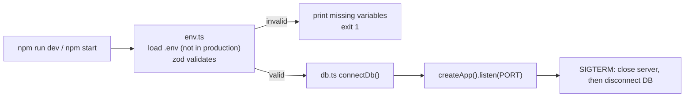
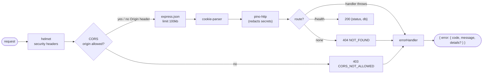
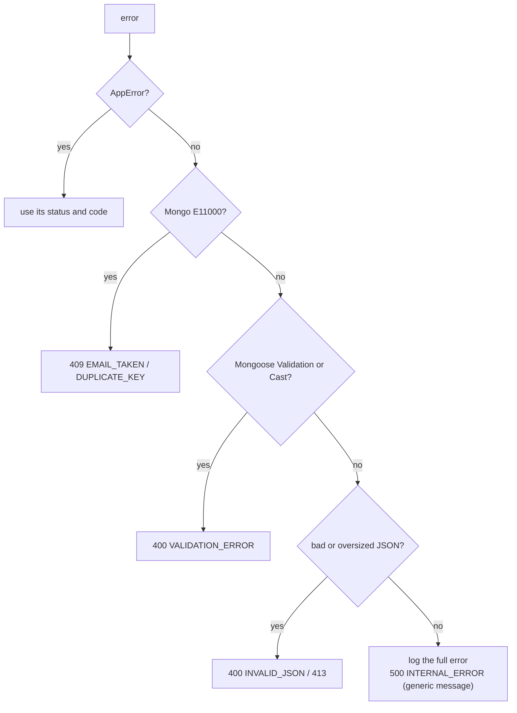

# Overview - Project setup

> **Status: done and verified** (2026-11-18). This describes what was actually built.

## In short

The backend is a hand-written Express 5 + TypeScript project. When it starts, it validates every environment variable with zod (and stops with a readable list if any are missing), connects to MongoDB, then listens. Every request passes through security headers (helmet), a CORS allow-list that permits cookies, a 100 KB JSON body limit, a cookie parser and a pino request logger that hides passwords, tokens and cookies. Every error, whether thrown on purpose or not, leaves the API in the same shape: `{ error: { code, message, details? } }`. Internal error messages are never sent to the client.

## What changed

| File | Change |
| --- | --- |
| `package.json` | Scripts: `dev` (tsx watch), `build`, `start`, `typecheck`, `test` |
| `tsconfig.json` / `tsconfig.build.json` | Strict TypeScript. The build config leaves out tests |
| `src/config/env.ts` | zod-validated config; loads `.env` locally through `process.loadEnvFile()` |
| `src/lib/logger.ts` | pino with redaction; pretty output in development, JSON in production, silent in tests |
| `src/lib/errors.ts` | `AppError`, `notFound()`, the 404 handler, and an error handler that maps duplicate keys (409), Mongoose validation and cast errors (400), bad JSON (400) and oversized bodies (413) |
| `src/app.ts` | `createApp()`: middleware order, `/health`, error handling |
| `src/db.ts` | Connect and disconnect; `autoIndex` off in production |
| `src/server.ts` | Startup and graceful shutdown on SIGTERM and SIGINT (Render sends SIGTERM) |
| `vitest.config.ts`, `tests/global-setup.ts`, `tests/setup.ts` | One in-memory MongoDB per test run, and a fresh database per test file |
| `tests/app.test.ts` | 7 tests |

## How it works

### Startup

### Request pipeline

### How errors are mapped

## Notes for the interview

- **Why `trust proxy = 1`:** Render puts one proxy in front of the app. Without this setting, `req.ip` would be the proxy's address, so rate limiting would treat every user as one client.
- **Why requests without an Origin header are allowed through CORS:** CORS is a browser mechanism. curl and server-to-server calls send no Origin, and authentication still protects every route that needs it.
- **Why bcryptjs instead of the `bcrypt` package (used from the next module on):** it's the same bcrypt algorithm and hash format, written in pure JavaScript, so there's no native compile step on Windows or Render.

## Where it fits

Part of [Milestone 1 - Foundation](../overview.md). Next: [Data models](../module-2-data-models/overview.md).
