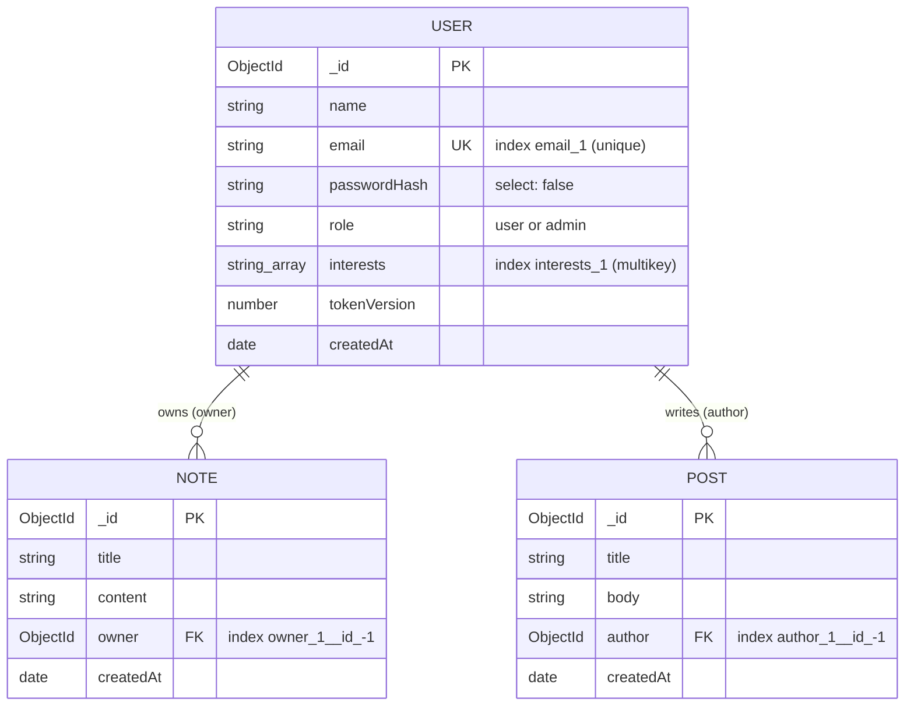

# Overview - Data models

> **Status: planned.** This file is rewritten with the real details when the module passes verification.

## In short

Defines the User, Note and Post Mongoose schemas with exactly four `schema.index()` calls, adds the `sync-indexes` script that makes the database match the code, and adds the admin seed and the demo-data seed.

## What changes

| File | Change |
| --- | --- |
| `src/models/user.model.ts` | New |
| `src/models/note.model.ts` | New |
| `src/models/post.model.ts` | New |
| `scripts/sync-indexes.ts` | New |
| `scripts/seed.ts`, `scripts/seed-demo.ts` | New |
| `tests/indexes.test.ts` | New |

## How it works

## Where it fits

Part of [Milestone 1 - Foundation](../overview.md).
