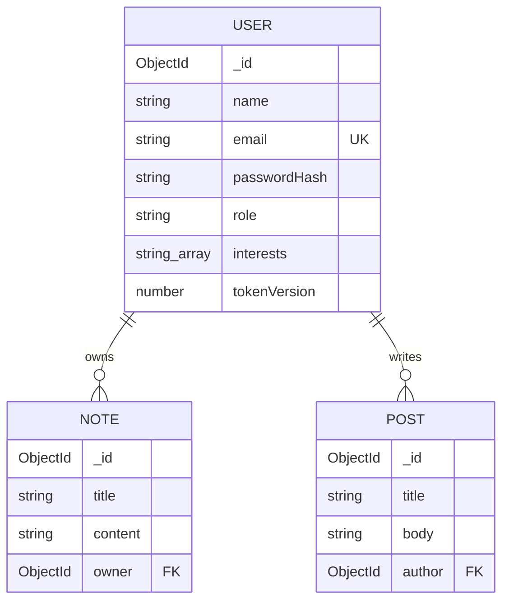
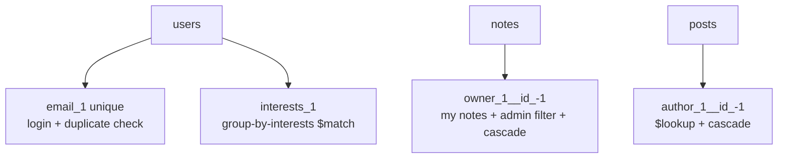

# Overview - Data models

> **Status: done and verified** (2026-11-18). This describes what was actually built.

## In short

Three Mongoose models (`User`, `Note`, `Post`) declare exactly four custom indexes with `schema.index()`. Emails and interests are lowercased. `passwordHash` is hidden by default. `npm run sync-indexes` makes Atlas match the schema. `npm run seed` upserts the admin; `npm run seed:demo` adds three demo users with overlapping interests plus notes and posts.

## What changed

| File | Change |
| --- | --- |
| `src/models/user.model.ts` | User schema + `email_1` unique + `interests_1` |
| `src/models/note.model.ts` | Note schema + `owner_1__id_-1` |
| `src/models/post.model.ts` | Post schema + `author_1__id_-1` |
| `src/models/index.ts` | Barrel export |
| `src/lib/password.ts` | bcryptjs hash/compare (cost 12) |
| `scripts/sync-indexes.ts` | `syncIndexes()` for all models |
| `scripts/seed.ts` | Admin upsert from `ADMIN_*` |
| `scripts/seed-demo.ts` | Demo users/notes/posts |
| `tests/indexes.test.ts` | Index set + normalization tests |
| `package.json` | `sync-indexes`, `seed`, `seed:demo` scripts |

## How it works

### Entity relationships

### Index plan (no extras)

## Seed credentials (local / Atlas demo)

| Account | Email | Password | Role |
| --- | --- | --- | --- |
| Admin | `admin@example.com` | from `.env` `ADMIN_PASSWORD` | admin |
| Alice | `alice@example.com` | `Demo12345!` | user |
| Bob | `bob@example.com` | `Demo12345!` | user |
| Carol | `carol@example.com` | `Demo12345!` | user |

## Where it fits

Part of [Milestone 1 - Foundation](../overview.md). Next: [Auth core](../../milestone-2-auth/module-1-auth-core/overview.md).
