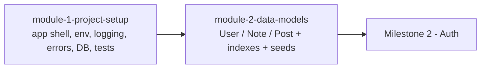

# Overview - Milestone 1 - Foundation

> **Status: in progress.** Module 1 and 2 verified.

## Goal

A runnable, tested Express + TypeScript backend with configuration, logging, error handling, the database connection, and the three Mongoose models carrying exactly the indexes from decision 23.

## Module flow

## Modules

- **[Project setup](./module-1-project-setup/overview.md):** Creates the backend project by hand: TypeScript config, npm scripts, environment validation with zod, the pino logger, the central error handler and error format, the `/health` route, the MongoDB connection, security middleware (helmet, CORS, trust proxy), and the test harness with an in-memory MongoDB.
- **[Data models](./module-2-data-models/overview.md):** Defines the User, Note and Post Mongoose schemas with exactly four `schema.index()` calls, adds the `sync-indexes` script that makes the database match the code, and adds the admin seed and the demo-data seed.
