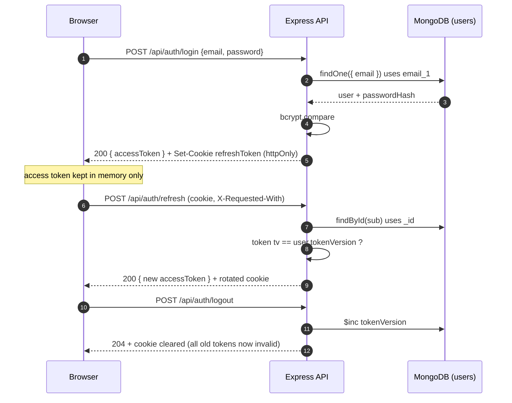

# Overview - Auth core

> **Status: planned.** This file is rewritten with the real details when the module passes verification.

## In short

Adds password hashing, JWT signing and verification, and the three auth endpoints. Login sets an httpOnly refresh cookie and returns an access token; refresh rotates the cookie; logout bumps `tokenVersion` so every outstanding token for that user dies.

## What changes

| File | Change |
| --- | --- |
| `src/lib/password.ts`, `src/lib/tokens.ts`, `src/lib/cookies.ts` | New |
| `src/middleware/validate.ts`, `csrf.ts`, `rate-limit.ts` | New |
| `src/routes/auth.routes.ts` | New |
| `src/app.ts` | Mount `/api/auth` and the global limiter |
| `tests/auth.test.ts` | New |

## How it works

## Where it fits

Part of [Milestone 2 - Auth](../overview.md).
