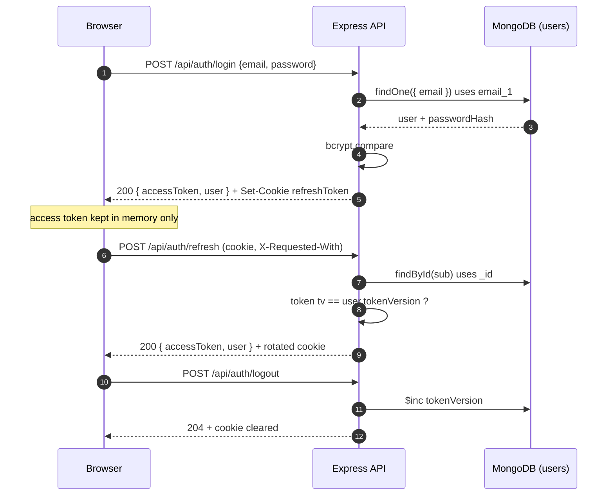

# Overview - Auth core

> **Status: done and verified** (2026-11-18). This describes what was actually built.

## In short

Login verifies bcrypt hashes, returns a 15-minute access JWT, and sets a 7-day httpOnly refresh cookie (`path=/api/auth`). Refresh requires `X-Requested-With`, checks `tokenVersion`, and rotates the cookie. Logout increments `tokenVersion` so every outstanding token for that user dies. Login is rate-limited to 10 attempts / 15 min per IP; the whole API is limited to 300 / 15 min.

## What changed

| File | Change |
| --- | --- |
| `src/lib/tokens.ts` | Access + refresh sign/verify (`tv`, `type`, unique `jti`) |
| `src/lib/cookies.ts` | `refreshToken` set/clear; prod `Secure; SameSite=None` |
| `src/lib/user-public.ts` | Safe user JSON for auth responses |
| `src/middleware/validate.ts` | zod body/query/params helpers |
| `src/middleware/csrf.ts` | Require `X-Requested-With` |
| `src/middleware/rate-limit.ts` | Login + global limiters |
| `src/routes/auth.routes.ts` | `POST /login`, `/refresh`, `/logout` |
| `src/app.ts` | Mount `/api/auth` + global limiter |
| `tests/auth.test.ts` | Success/fail, CSRF, rotation, logout revoke, rate limit |

## How it works

## Where it fits

Part of [Milestone 2 - Auth](../overview.md). Next: [RBAC and profile](../module-2-rbac-and-profile/overview.md).
