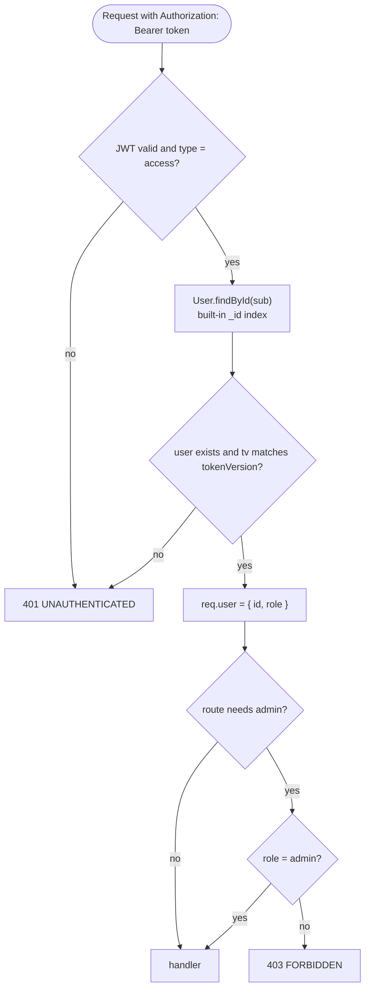

# Overview - RBAC and profile

> **Status: planned.** This file is rewritten with the real details when the module passes verification.

## In short

Adds the `authenticate` middleware (verifies the Bearer token and reloads the user by `_id`, so deleted users and role changes take effect immediately), the `requireRole('admin')` guard, and the user's own profile endpoints.

## What changes

| File | Change |
| --- | --- |
| `src/middleware/authenticate.ts`, `require-role.ts` | New |
| `src/lib/object-id.ts` | New |
| `src/routes/me.routes.ts` | New |
| `tests/me.test.ts` | New |

## How it works

## Where it fits

Part of [Milestone 2 - Auth](../overview.md).
