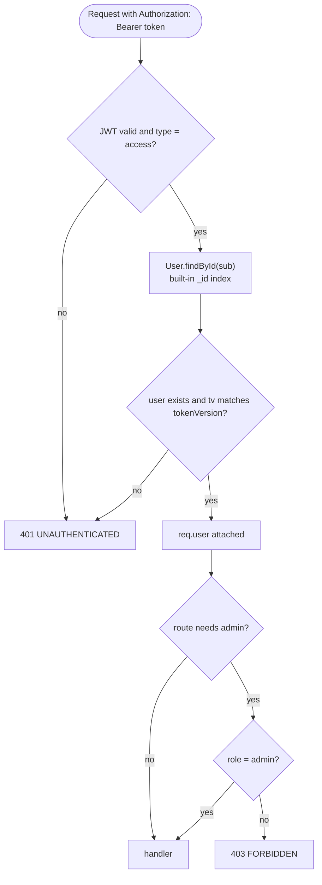

# Overview - RBAC and profile

> **Status: done and verified** (2026-11-18). This describes what was actually built.

## In short

`authenticate` verifies the Bearer access JWT, reloads the user by `_id`, and checks `tokenVersion` so deleted users and revocations take effect immediately. `requireRole('admin')` returns `403 FORBIDDEN` for non-admins. `GET/PATCH /api/users/me` lets a user read and update name, interests, and password; a password change bumps `tokenVersion` and clears the refresh cookie.

## What changed

| File | Change |
| --- | --- |
| `src/middleware/authenticate.ts` | Bearer verify + DB re-check → `req.user` |
| `src/middleware/require-role.ts` | Role gate |
| `src/lib/object-id.ts` | zod ObjectId helpers (400 on bad ids) |
| `src/routes/me.routes.ts` | `GET/PATCH /api/users/me` |
| `src/types/auth.ts`, `express.d.ts` | `req.user` typing |
| `src/app.ts` | Mount `/api/users` |
| `tests/me.test.ts` | Authz + profile coverage |

## How it works

## Where it fits

Part of [Milestone 2 - Auth](../overview.md). Milestone 2 complete. Next: [Milestone 3 - Notes](../../milestone-3-notes/overview.md).
