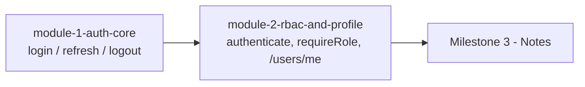

# Overview - Milestone 2 - Auth

> **Status: planned.** Updated as each module passes verification.

## Goal

Secure login with bcrypt-hashed passwords, a 15-minute access token, a rotating 7-day refresh cookie, revocation through `tokenVersion`, rate limiting, role checks, and the user's own profile endpoints.

## Module flow

## Modules

- **[Auth core](./module-1-auth-core/overview.md):** Adds password hashing, JWT signing and verification, and the three auth endpoints. Login sets an httpOnly refresh cookie and returns an access token; refresh rotates the cookie; logout bumps `tokenVersion` so every outstanding token for that user dies.
- **[RBAC and profile](./module-2-rbac-and-profile/overview.md):** Adds the `authenticate` middleware (verifies the Bearer token and reloads the user by `_id`, so deleted users and role changes take effect immediately), the `requireRole('admin')` guard, and the user's own profile endpoints.
