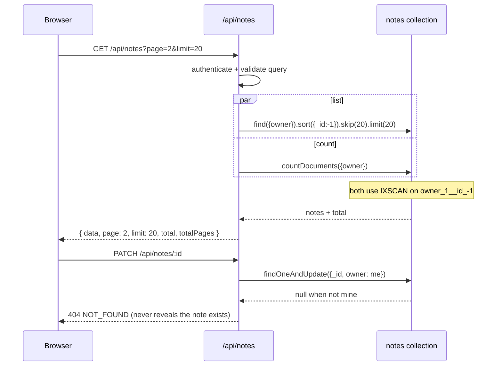

# Overview - Notes CRUD

> **Status: planned.** This file is rewritten with the real details when the module passes verification.

## In short

Adds the shared pagination helper and the five note endpoints. Every write is scoped to the owner in the query itself, so a user (or admin) touching someone else's note simply gets 404.

## What changes

| File | Change |
| --- | --- |
| `src/lib/pagination.ts` | New |
| `src/routes/notes.routes.ts` | New |
| `src/app.ts` | Mount `/api/notes` |
| `tests/notes.test.ts` | New |

## How it works

## Where it fits

Part of [Milestone 3 - Notes](../overview.md).
