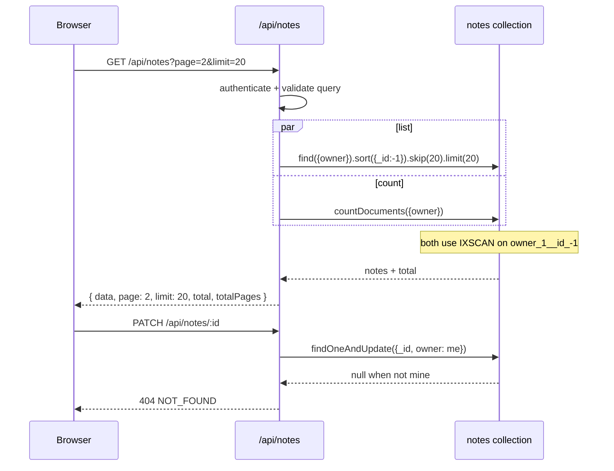

# Overview - Notes CRUD

> **Status: done and verified** (2026-11-18). This describes what was actually built.

## In short

Shared pagination (`page`/`limit`, cap 100) plus five note endpoints. Lists and counts use `{ owner }` with `owner_1__id_-1`. Writes always include `owner: me` in the filter so another user's note (or an admin editing someone else's) returns `404` without leaking existence. Admins may `GET` any note by `_id`.

## What changed

| File | Change |
| --- | --- |
| `src/lib/pagination.ts` | Query schema + `{ data, page, limit, total, totalPages }` |
| `src/routes/notes.routes.ts` | CRUD under `/api/notes` |
| `src/app.ts` | Mount notes router |
| `tests/notes.test.ts` | Owner scope, admin read-only, pagination, validation |

## How it works

## Where it fits

Part of [Milestone 3 - Notes](../overview.md). Next: [Admin notes list](../module-2-admin-notes/overview.md).
