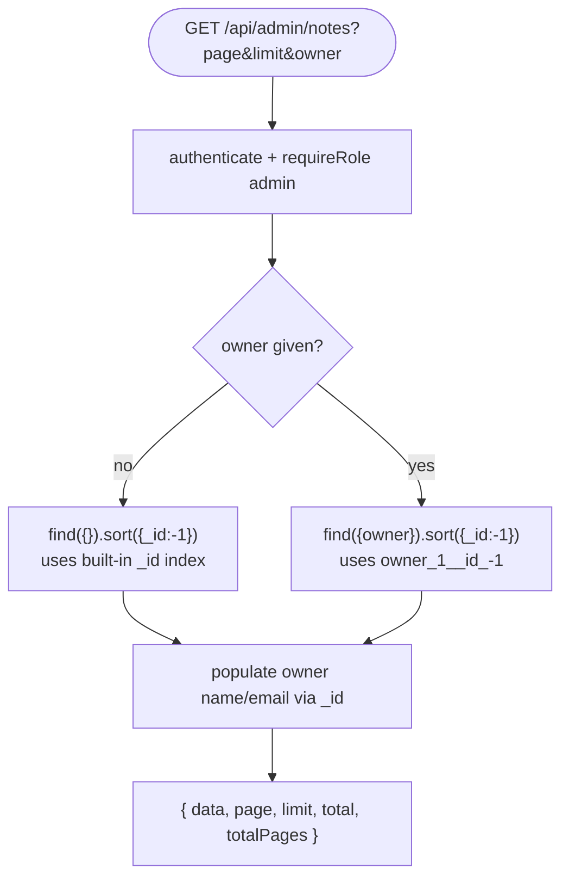

# Overview - Admin notes

> **Status: planned.** This file is rewritten with the real details when the module passes verification.

## In short

Adds `GET /api/admin/notes`, a paginated newest-first list of every note with an optional `?owner=` filter. Without the filter it walks the built-in `_id` index; with it, it reuses the owner index. No new index is created.

## What changes

| File | Change |
| --- | --- |
| `src/routes/admin-notes.routes.ts` | New |
| `src/app.ts` | Mount `/api/admin/notes` |
| `tests/admin-notes.test.ts` | New |

## How it works

## Where it fits

Part of [Milestone 3 - Notes](../overview.md).
