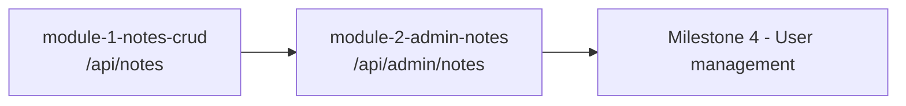

# Overview - Milestone 3 - Notes

> **Status: planned.** Updated as each module passes verification.

## Goal

Users manage their own notes with pagination; admins can list and read everyone's notes but cannot modify them.

## Module flow

## Modules

- **[Notes CRUD](./module-1-notes-crud/overview.md):** Adds the shared pagination helper and the five note endpoints. Every write is scoped to the owner in the query itself, so a user (or admin) touching someone else's note simply gets 404.
- **[Admin notes](./module-2-admin-notes/overview.md):** Adds `GET /api/admin/notes`, a paginated newest-first list of every note with an optional `?owner=` filter. Without the filter it walks the built-in `_id` index; with it, it reuses the owner index. No new index is created.
