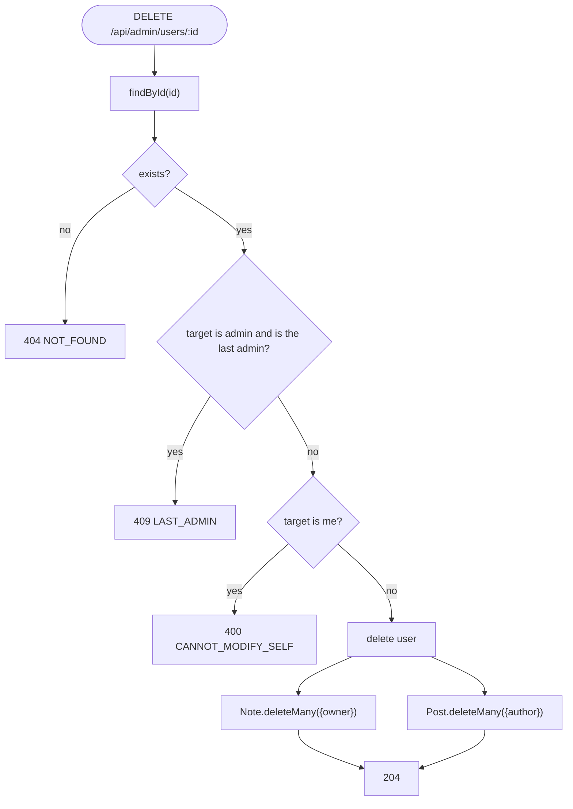

# Overview - Admin users

> **Status: done and verified** (2026-11-18). This describes what was actually built.

## In short

`/api/admin/users` supports list, create, read, update and delete. Duplicate emails return `409 EMAIL_TAKEN`. Self-delete/demote is blocked (`400 CANNOT_MODIFY_SELF`) when another admin exists; removing the last admin returns `409 LAST_ADMIN`. Delete cascades to notes and posts. Role or password changes bump `tokenVersion`.

## What changed

| File | Change |
| --- | --- |
| `src/routes/admin-users.routes.ts` | Admin user CRUD + guards + cascade |
| `src/app.ts` | Mount `/api/admin/users` |
| `tests/admin-users.test.ts` | CRUD, guards, cascade, token revoke |

## How it works

## Where it fits

Part of [Milestone 4 - User management](../overview.md). Milestone 4 complete. Next: [Milestone 5 - Posts and aggregations](../../milestone-5-posts-and-aggregations/overview.md).
