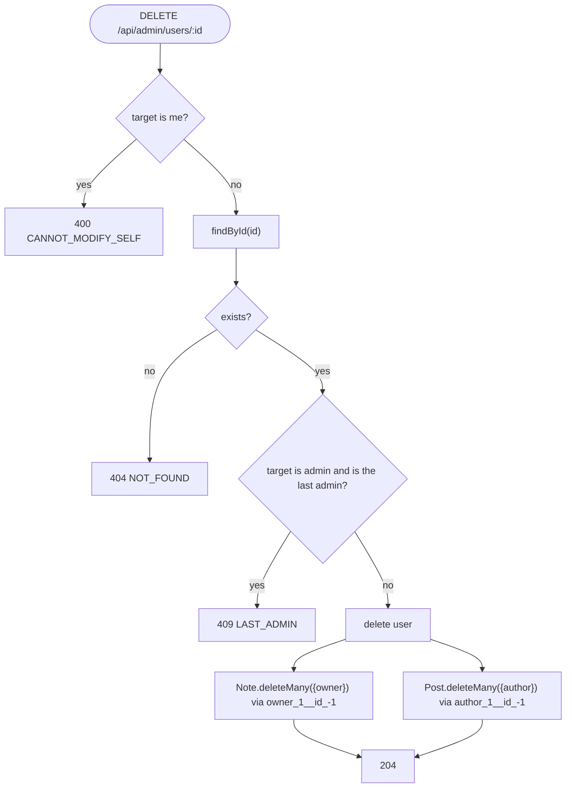

# Overview - Admin users

> **Status: planned.** This file is rewritten with the real details when the module passes verification.

## In short

Adds the five `/api/admin/users` endpoints. Deleting a user also deletes their notes and posts; admins cannot delete or demote themselves, and the last admin can never be removed or demoted.

## What changes

| File | Change |
| --- | --- |
| `src/routes/admin-users.routes.ts` | New |
| `src/app.ts` | Mount `/api/admin/users` |
| `tests/admin-users.test.ts` | New |

## How it works

## Where it fits

Part of [Milestone 4 - User management](../overview.md).
