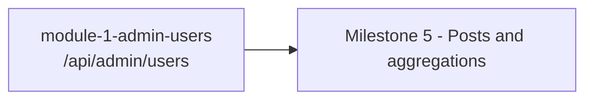

# Overview - Milestone 4 - User management

> **Status: planned.** Updated as each module passes verification.

## Goal

Admins add, list, read, update and remove users, with guardrails that make it impossible to lock everyone out, and cascade deletes for the removed user's content.

## Module flow

## Modules

- **[Admin users](./module-1-admin-users/overview.md):** Adds the five `/api/admin/users` endpoints. Deleting a user also deletes their notes and posts; admins cannot delete or demote themselves, and the last admin can never be removed or demoted.
