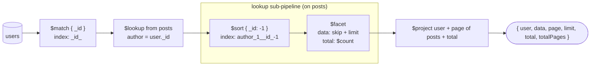

# Overview - Posts and $lookup

> **Status: planned.** This file is rewritten with the real details when the module passes verification.

## In short

Adds creating and deleting posts, and `GET /api/users/:id/posts`, which runs one aggregation on the users collection: match the user by `_id`, then `$lookup` their posts with sorting, pagination and the total count done inside the lookup.

## What changes

| File | Change |
| --- | --- |
| `src/routes/posts.routes.ts` | New |
| `src/services/user-posts.aggregation.ts` | New |
| `src/routes/users.routes.ts` | New: `GET /api/users/:id/posts` |
| `tests/posts.test.ts` | New |

## How it works

## Where it fits

Part of [Milestone 5 - Posts and aggregations](../overview.md).
