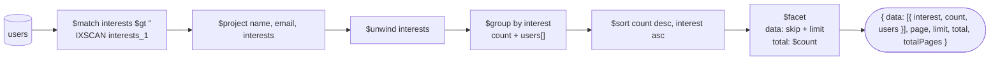

# Overview - Interests aggregation

> **Status: planned.** This file is rewritten with the real details when the module passes verification.

## In short

Adds `GET /api/users/by-interest` (admin only): one `User.collection.aggregate()` call that starts with an index-backed `$match` on `interests`, unwinds, groups users per interest, sorts, and paginates the groups with `$facet`.

## What changes

| File | Change |
| --- | --- |
| `src/services/interests.aggregation.ts` | New |
| `src/routes/users.routes.ts` | Add `GET /api/users/by-interest` |
| `tests/interests.test.ts` | New |

## How it works

## Where it fits

Part of [Milestone 5 - Posts and aggregations](../overview.md).
