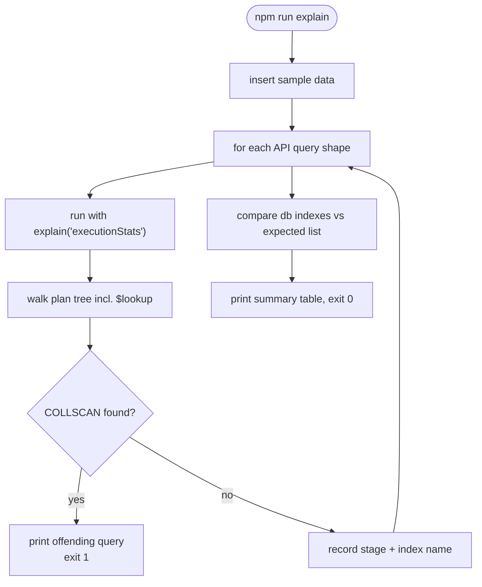

# Overview - Index verification

> **Status: planned.** This file is rewritten with the real details when the module passes verification.

## In short

Adds `npm run explain`, which runs every query and aggregation the API uses with `explain()`, prints the winning plan and index for each, and exits with an error if any plan contains `COLLSCAN`. It also checks the database holds exactly the indexes declared in code.

## What changes

| File | Change |
| --- | --- |
| `scripts/explain.ts` | New |
| `package.json` | Add `explain` script |
| `tests/explain.test.ts` | New |

## How it works

## Where it fits

Part of [Milestone 5 - Posts and aggregations](../overview.md).
