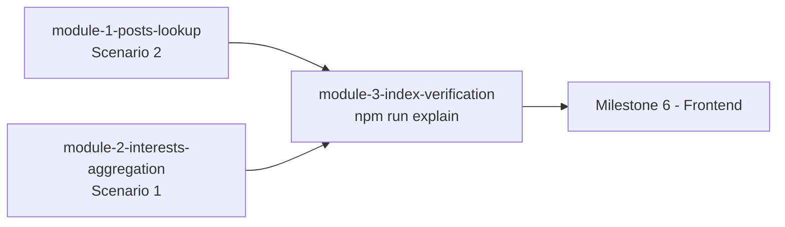

# Overview - Milestone 5 - Posts and aggregations

> **Status: done.** All three modules verified.

## Goal

The two aggregation scenarios from the PDF, each backed by an index, plus a script that proves no query in the API does a collection scan.

## Module flow

## Modules

- **[Posts and $lookup](./module-1-posts-lookup/overview.md):** Create/delete posts + `GET /users/:id/posts` with `$lookup`.
- **[Interests aggregation](./module-2-interests-aggregation/overview.md):** Admin `GET /users/by-interest` with one aggregate.
- **[Index verification](./module-3-index-verification/overview.md):** `npm run explain` — no COLLSCAN, exact indexes.
