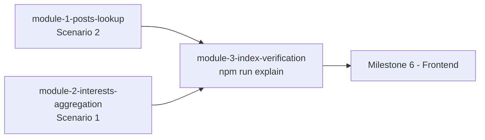

# Overview - Milestone 5 - Posts and aggregations

> **Status: planned.** Updated as each module passes verification.

## Goal

The two aggregation scenarios from the PDF, each backed by an index, plus a script that proves no query in the API does a collection scan.

## Module flow

## Modules

- **[Posts and $lookup](./module-1-posts-lookup/overview.md):** Adds creating and deleting posts, and `GET /api/users/:id/posts`, which runs one aggregation on the users collection: match the user by `_id`, then `$lookup` their posts with sorting, pagination and the total count done inside the lookup.
- **[Interests aggregation](./module-2-interests-aggregation/overview.md):** Adds `GET /api/users/by-interest` (admin only): one `User.collection.aggregate()` call that starts with an index-backed `$match` on `interests`, unwinds, groups users per interest, sorts, and paginates the groups with `$facet`.
- **[Index verification](./module-3-index-verification/overview.md):** Adds `npm run explain`, which runs every query and aggregation the API uses with `explain()`, prints the winning plan and index for each, and exits with an error if any plan contains `COLLSCAN`. It also checks the database holds exactly the indexes declared in code.
