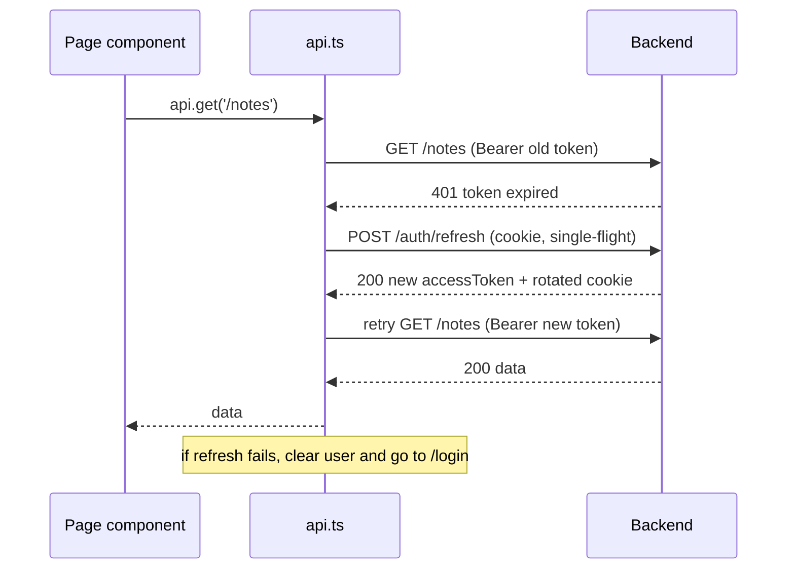

# Overview - Frontend foundation

> **Status: planned.** This file is rewritten with the real details when the module passes verification.

## In short

Creates the Next.js project by hand, the API client (attaches the Bearer token, sends cookies, refreshes once on 401 and retries), the auth context that restores the session on page load, the login page, the navigation bar and the route guards.

## What changes

| File | Change |
| --- | --- |
| `frontend/package.json`, `tsconfig.json`, `next.config.mjs` | New |
| `frontend/src/lib/api.ts`, `auth-context.tsx` | New |
| `frontend/src/app/layout.tsx`, `login/page.tsx` | New |
| `frontend/src/components/nav.tsx`, `guards.tsx` | New |

## How it works

## Where it fits

Part of [Milestone 6 - Frontend](../overview.md).
