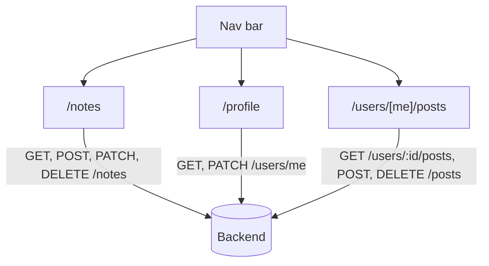

# Overview - Frontend user pages

> **Status: planned.** This file is rewritten with the real details when the module passes verification.

## In short

Builds the pages every user sees: `/notes` (paginated list, create, edit, delete), `/profile` (name, interests, password) and `/users/[id]/posts` (a user's posts, with create and delete on your own).

## What changes

| File | Change |
| --- | --- |
| `frontend/src/components/pagination.tsx` | New |
| `frontend/src/app/notes/page.tsx` | New |
| `frontend/src/app/profile/page.tsx` | New |
| `frontend/src/app/users/[id]/posts/page.tsx` | New |

## How it works

## Where it fits

Part of [Milestone 6 - Frontend](../overview.md).
