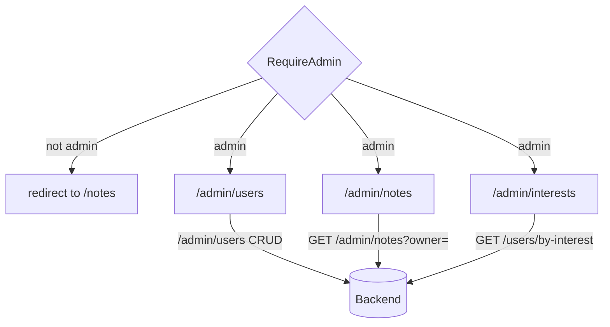

# Overview - Frontend admin pages

> **Status: planned.** This file is rewritten with the real details when the module passes verification.

## In short

Builds the admin-only pages: `/admin/users` (create, edit, delete, list), `/admin/notes` (all notes with a user filter) and `/admin/interests` (the grouped view). The nav shows these links only to admins, and the guard redirects anyone else.

## What changes

| File | Change |
| --- | --- |
| `frontend/src/app/admin/users/page.tsx` | New |
| `frontend/src/app/admin/notes/page.tsx` | New |
| `frontend/src/app/admin/interests/page.tsx` | New |

## How it works

## Where it fits

Part of [Milestone 6 - Frontend](../overview.md).
