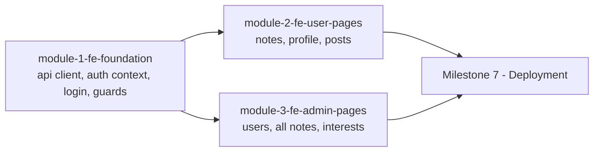

# Overview - Milestone 6 - Frontend

> **Status: planned.** Updated as each module passes verification.

## Goal

A hand-written Next.js (App Router) + TypeScript client that exercises every endpoint. Function over style.

## Module flow

## Modules

- **[Frontend foundation](./module-1-fe-foundation/overview.md):** Creates the Next.js project by hand, the API client (attaches the Bearer token, sends cookies, refreshes once on 401 and retries), the auth context that restores the session on page load, the login page, the navigation bar and the route guards.
- **[Frontend user pages](./module-2-fe-user-pages/overview.md):** Builds the pages every user sees: `/notes` (paginated list, create, edit, delete), `/profile` (name, interests, password) and `/users/[id]/posts` (a user's posts, with create and delete on your own).
- **[Frontend admin pages](./module-3-fe-admin-pages/overview.md):** Builds the admin-only pages: `/admin/users` (create, edit, delete, list), `/admin/notes` (all notes with a user filter) and `/admin/interests` (the grouped view). The nav shows these links only to admins, and the guard redirects anyone else.
