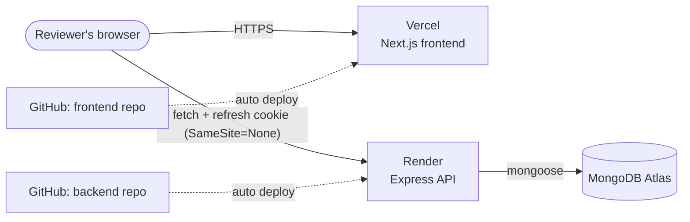

# Overview - Deploy

> **Status: planned.** This file is rewritten with the real details when the module passes verification.

## In short

Pushes both repos to GitHub, deploys the backend to Render and the frontend to Vercel, wires the production cookie and CORS settings, runs the index sync and seeds against Atlas, and verifies the full flow on the live URLs.

## What changes

| File | Change |
| --- | --- |
| `backend/README.md`, `backend/render.yaml` | New |
| `frontend/README.md` | New |

## How it works

## Where it fits

Part of [Milestone 7 - Deployment](../overview.md).
