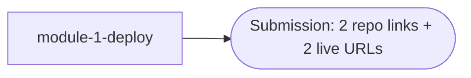

# Overview - Milestone 7 - Deployment

> **Status: planned.** Updated as each module passes verification.

## Goal

Both apps live on free hosting, pushed to two GitHub repos, with READMEs good enough to run the project locally during the interview.

## Module flow

## Modules

- **[Deploy](./module-1-deploy/overview.md):** Pushes both repos to GitHub, deploys the backend to Render and the frontend to Vercel, wires the production cookie and CORS settings, runs the index sync and seeds against Atlas, and verifies the full flow on the live URLs.
