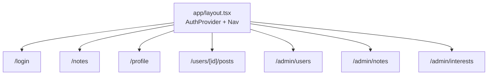

# Secure Notes - Frontend Guide

_Updated after each module. Last updated: 2026-11-18 01:05 (UTC+6)._

## Stack

Next.js (App Router) + TypeScript, written by hand. All pages are client components. One plain CSS file.

## Planned component tree



## Auth and state

- The access token lives in memory inside `AuthProvider`; on page load the app calls `POST /auth/refresh` to restore the session from the httpOnly cookie.
- Every request goes through `src/lib/api.ts`, which sends `credentials: 'include'`, the Bearer token and `X-Requested-With: XMLHttpRequest`, and on a 401 refreshes once and retries.

## Backend contracts available to the frontend

### Error shape (every endpoint)

```ts
type ApiError = { error: { code: string; message: string; details?: unknown } };
```

Show `error.message` to the user. Branch on `error.code` where the UI needs to react (for example `UNAUTHENTICATED` triggers a refresh, and `EMAIL_TAKEN` highlights the email field).

### CORS

- The backend only accepts browser requests from origins listed in `CORS_ORIGINS` (locally `http://localhost:3000`, the Next.js dev server).
- Credentials are allowed, so the frontend must use `credentials: 'include'` for the refresh cookie to be sent.
- Allowed request headers: `Content-Type`, `Authorization`, `X-Requested-With`.

### Health

`GET {API_ORIGIN}/health` returns `{ status, db }`. Note that it's outside `/api`.
