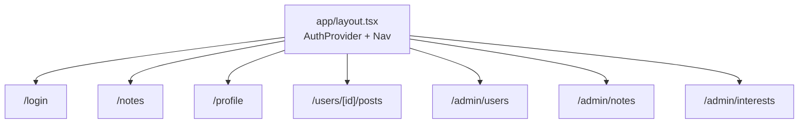

# Secure Notes - Frontend Guide

_Updated after each module. Last updated: 2026-11-18 03:25 (UTC+6)._

## Stack

Next.js 15 (App Router) + TypeScript, written by hand. All pages are client components. One plain CSS file (`src/app/globals.css`).

## Run

```bash
cd frontend
cp .env.example .env.local
npm install
npm run dev
```

`NEXT_PUBLIC_API_URL` must point at the API including `/api` (local default `http://localhost:4000/api`). Backend `CORS_ORIGINS` must include `http://localhost:3000`.

## Component tree



## Auth and state

- Access token lives in memory inside `AuthProvider` (ref-backed so refresh retries see it immediately).
- On load: `POST /auth/refresh` restores the session from the httpOnly cookie.
- `src/lib/api.ts` sends `credentials: 'include'`, Bearer token, and `X-Requested-With: XMLHttpRequest`.
- Concurrent 401s share one refresh (single-flight), then retry once.

## Error shape

```ts
type ApiError = { error: { code: string; message: string; details?: unknown } };
```

Show `error.message`. Branch on `error.code` when needed (`EMAIL_TAKEN`, `CANNOT_MODIFY_SELF`, `LAST_ADMIN`, …).

## Manual smoke checklist

1. Log in as admin → reload keeps session.
2. Create / edit / delete a note.
3. Update profile interests; change password → redirected to login.
4. Publish and delete own posts on `/users/<me>/posts`.
5. Admin: create user, filter notes by owner, open interests groups.
6. Log in as regular user → `/admin/*` redirects to `/notes`.
